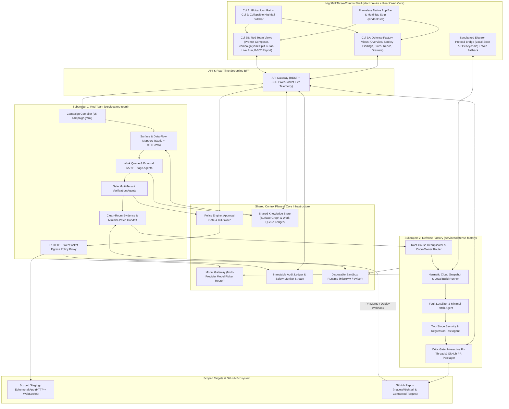
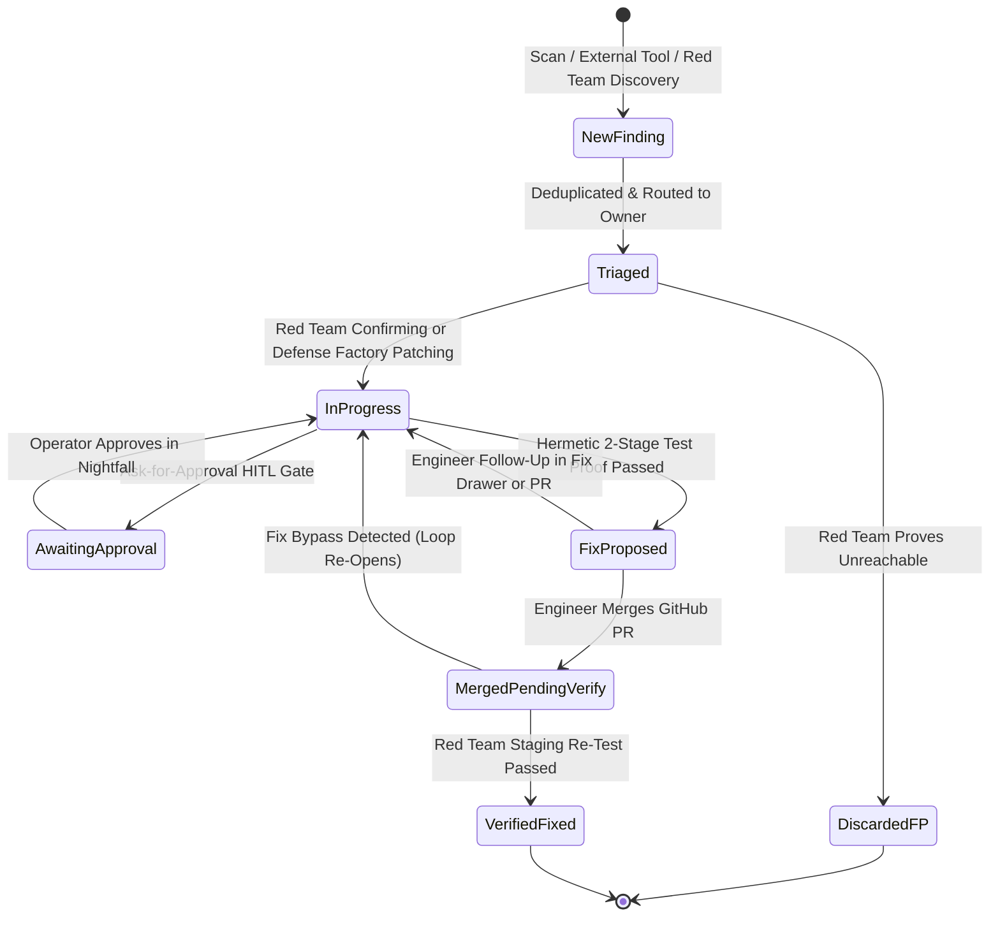

# Nightfall Build Plan: Red Team, Defense Factory & Three-Column Desktop/Web UI

**Target Repository:** https://github.com/maceip/Nightfall

## 1. Executive Architecture & Core Design Principles

**Nightfall** is a unified, closed-loop application security platform organized around two autonomous subprojects inside a single **three-column native-chrome Electron + Web application**:

1. **Red Team (`services/red-team`)**: The Automated Application Security Assessment Platform—combining source-archive/repo intelligence with scoped, non-destructive HTTP and WebSocket verification (`campaign.yaml`) against staging/ephemeral targets to confirm real weaknesses, discard static false positives, and re-test patches.
2. **Defense Factory (`services/defense-factory`)**: The Continuous Vulnerability Remediation Platform—converting confirmed Red Team and external scanner findings into root-cause-deduplicated, hermetic test-proven fixes (`Fixes`), interactive fix refinement threads, and review-ready GitHub pull requests.
3. **Nightfall Desktop & Web Shell (`apps/nightfall-ui`)**: A **shared React/TypeScript/Vite web core wrapped in a thin `electron-vite` desktop shell** implementing the custom frameless tab/title bar and three-column workspace seen across all 18 mock screens, strictly unified under the **`Nightfall`** brand.
4. **Closed-Loop Orchestrator (`services/closed-loop-orchestrator`)**: Durable workflow engine binding Red Team confirmations, Defense Factory fix synthesis, engineer review, and post-deploy fix verification.

> [!IMPORTANT]
> **Safety-First Architectural Invariant:** Scope boundaries (`campaign.yaml`), HTTP/WebSocket allowlists, rate caps (`max_requests_per_second`), and `Ask for approval` HITL gates are enforced **deterministically in infrastructure** via the L7 Egress Policy Proxy and disposable sandboxes—powering the live **Safety monitor** status bar (*"Requests stay within the approved staging scope"*).

### High-Level System Architecture



---

## 2. UI Runtime Architecture Decision: Shared Web Core + Thin Electron Shell

### Trade-Off Evaluation (`Electron` vs. `Nucleus` vs. `Native` vs. `Web-Only`)

| Option | Dev Velocity | Native Titlebar & 3-Panel Fidelity | `Local` Scan & Repo Access | Browser Preview & CI Testing | Verdict |
| :--- | :---: | :---: | :---: | :---: | :--- |
| **Shared React/Vite Web Core + Thin `electron-vite` Shell** | **Highest** | **100% Native (`hiddenInset`)** | **Full (Sandboxed IPC)** | **Instant (`pnpm dev:web`)** | **Selected Architecture** |
| **Web-Only SPA** | High | Partial (browser URL bar above app tabs; no traffic-light inset) | Requires manual local CLI setup | Instant | Used as the **inner renderer** (`95%` of code), not standalone |
| **Heavy IPC-Coupled Electron** | Medium | 100% Native | Full | Slower E2E / no zero-install URL sharing | Avoid tight Electron coupling in UI components |
| **Nucleus / Lightweight OS WebView Wrappers** | Medium-Low | OS-dependent quirks | Custom native bridge work | WebKit vs. Blink CSS/SVG drift | Rejected due to chart/diff rendering variance & tooling friction |
| **Roll Native (SwiftUI / WinUI / GTK)** | **Lowest** | 100% Native | Full | Expensive OS-specific UI automation | Rejected—3–5x slower iteration on Sankey, diff, and streaming UI |

### How the Selected Hybrid Shell Maximizes Velocity

1. **`95%` Pure Web Renderer (`apps/nightfall-ui/src/renderer`)**:
   - Built with **React 19 + TypeScript + Vite + Tailwind CSS**, zero direct Node/Electron imports in React views.
   - Runs directly in any browser (`pnpm dev:web`) with `< 50ms` HMR, instant cloud previews, shareable deep links, and fast headless Playwright visual/interaction testing.
2. **`5%` Thin Hardened Electron Shell (`apps/nightfall-ui/src/main` & `src/preload` via `electron-vite`)**:
   - Configures `BrowserWindow` with `titleBarStyle: 'hiddenInset'` (macOS traffic lights inset inline with `← →`, sidebar toggle, and tab strip) and `titleBarOverlay` (Windows/Linux), using CSS `app-region: drag` on the custom top bar and `app-region: no-drag` on interactive tabs/buttons.
   - Exposes a minimal typed `window.nightfallDesktop` preload bridge (`contextIsolation: true`, `sandbox: true`, `nodeIntegration: false`, strict CSP) to power the **`Local`** scan option in the `New scan` drawer, local `campaign.yaml`/archive picking, OS notifications on HITL gates, and `safeStorage` token persistence.

---

## 3. Nightfall Screen-by-Screen UI Specification (From All 18 Mocks)

> [!NOTE]
> **Strict Brand Unification Rule:** Every screen, navigation header, browser/app tab, agent badge, snapshot label, and slide-over drawer uses **`Nightfall`** nomenclature—replacing all legacy `"Daybreak"` and `"Codex"` strings across the entire product:
> - Sidebar brand header: **`Nightfall`** (per `IMG-20261112-WA8349.jpg`)
> - Red Team agent pill & tab title: **`Nightfall Red Team`**
> - Remediation slide-over drawer: **`Fix with Nightfall`**
> - Snapshot provenance subtitle: **`Nightfall · Cloud snapshot`** / **`Nightfall · Local snapshot`**

### 3.1 Three-Column Chrome & Navigation Shell

- **Top Custom App Bar (`40px` height)**:
  - Left: Window traffic-light inset (`72px` on macOS Electron, hidden cleanly in browser mode) + History `←` `→` buttons + Collapsible Left Panel toggle icon.
  - Center/Right: Contextual workspace breadcrumb (`Assess tenant isolation...`) or multi-tab strip (`campaign.yaml`, `Nightfall Red Team` with hexagonal blue emblem, `+` new tab) + fullscreen/expand toggle.
- **Column 1 — Far-Left Global Icon Rail (`48px` fixed)**:
  - Top-to-bottom icon slots: Home/Prompt Workspace, Threads/Artifacts, Run History, Scheduled/Automations, More (`...`), **Nightfall Security** (horizon emblem, active rounded state), Git/Patches, Workspace Grid.
- **Column 2 — Collapsible `Nightfall` Product Sidebar (`220px` collapsible)**:
  - Top header: **`Nightfall`** wordmark + collapse panel button.
  - Primary trigger: `+ New scan` (opens the right-hand `New scan` slide-over drawer).
  - Core Defense Factory & AppSec navigation:
    - `Overview`
    - `</> Fixes` (count pill + unread blue dot indicator when new fix proposals finish)
    - `Findings` (open findings count pill, e.g., `550`)
    - `Repositories`
    - `Scans`
  - Section divider + Red Team entry:
    - `Red Team` (shield-magnifier icon + purple `New` pill badge)
  - Bottom pinned: `Settings`.
- **Column 3 — Adaptive Main Canvas + Contextual 3rd Sub-Panel**:
  - Top filter/breadcrumb bar (`All repos v / Overview`, `All repos v / Findings`, `Findings / SEC-1034`).
  - Adapts its right-side third panel by context: **Sticky Metadata Rail** (Finding & Campaign Reports), **Stacked Slide-Over Drawers** (`Fix with Nightfall` + `New scan`), or **50/50 Split Artifact Editor** (`campaign.yaml`).

### 3.2 Defense Factory & Core AppSec Screens

| Screen / View | Mock Reference(s) | Exact UI Components & Interactive Behavior |
| :--- | :--- | :--- |
| **`Overview` Dashboard** | `201748~2`, `201752~2` | 1. **Proposed fixes** horizontal 3-card row (`Fix title`, `Fixes N finding`, repo slug, `Proposed` pill, `Review` button, count link `6 >`). 2. **Split Posture Card**: left `Open findings` total with interactive hoverable horizontal bars (`Critical` red, `High` orange, `Medium` amber); right `Fixed findings` with `Daily trend · last 7 days (UTC)` chart (`Currently fixed` solid green vs. `New findings` dashed crimson). 3. **Finding status** 4-column counter strip (`New`, `Triaged`, `In Progress`, `Fixed` + `All time v` selector). |
| **`Findings` Explorer & Sankey** | `WA8349`, `201759~2`, `201801~2`, `201810~2` | 1. Top CTA banner (`</> Review N proposed fixes...` + dark `View fixes` pill button). 2. Search input + `Open findings` state dropdown + `Filters` + `...`. 3. **Interactive 3-Stage Sankey Diagram**: `Findings (Total)` → Severity (`Critical`, `High`, `Medium`, `Low`, `Informational`) → Workflow Status (`New`, `Triaged`, `In Progress`). Clicking a node (e.g., `Critical 31`) highlights its flow ribbons (`In Progress 13`, `Triaged 13`, `New 5`) and filters the table below. 4. **Findings Data Table**: bulk-select checkbox, `Severity` badge, `Finding` title + `repo · SEC-ID · boundary note`, `Owner` avatar chip, `Sources` icon badges (`Nightfall` + external/AI sources), and `Status` pill. |
| **Finding Detail (`SEC-1034`)** | `201812~2` | Top actions (`Mark as duplicate`, `Continue fix` split button). Center narrative (`SUMMARY`, `ROOT CAUSE`, `IMPACT AND ATTACK PATH` with `Preconditions` bullets, `REMEDIATION`). Sticky right metadata column (`REPORTED SEVERITY`, `STATUS` selector, `FIX VERIFICATION` badge, `REPOSITORY`, `OBSERVED REVISION` commit hash, `WEAKNESS` CWE, `OBSERVED BY`, `OWNER`). |
| **`Fix with Nightfall` Drawer** | `201839~2` | Slide-over interactive remediation thread attached to a finding: background request prompt, collapsible `✓ Fix prepared` step log, `Proposed fix 1` summary card (`2 changed files`, `Review changes` button), and `+ Ask for follow-up` composer for engineer-guided patch refinement. |
| **`Fixes` Queue** | `201808~2` | Dedicated Defense Factory patch table: `Fix` title & root-cause subtitle, `Repository` (`repo` + `Nightfall · Cloud snapshot` or issue ID), `Findings` count + severity pill, `Status` (`Proposed`, `In progress`), `Review` / `View progress` button, and dismissible bottom-right batch progress toast. |
| **`Repositories` Coverage** | `201848~2` | Top `Enable security scans` dark CTA; 3 coverage KPI cards (`PR review coverage 29/36`, `Scheduled scan coverage 29/36`, `Need attention 6`); search + `Filters`; repository table (`PR reviews: Enabled` green pill, `Scheduled scans: Daily at 8:00 AM UTC` green pill, `Last completed scan`, `Owner` team, per-repo settings gear, `Scan` button). |
| **`New scan` Slide-Over Drawer** | `201839~2` | Modal/drawer with `Cloud · Recommended` vs. `Local` segmented toggle, `Repository` combobox, `Scan method` radio list (`Repository scan`, `Continuous monitoring`, `Scheduled scan`), `Scope` radio list (`Full repository`, `Specific folder or files`), and `Cancel` / `Start Scan` footer. |

### 3.3 Red Team Screens

| Screen / View | Mock Reference(s) | Exact UI Components & Interactive Behavior |
| :--- | :--- | :--- |
| **Campaign Prompt Composer** | `201550~2` | Clean entry canvas (*"What should we work on in `<Workspace>`?"*); target context bar (`[Globe] Staging target` + `[Folder] Source repo` + settings gear); rich prompt input supporting `@`-tool invocation (`Use Nightfall Red Team to assess: <url>`); bottom bar with `+` file/token attach, **`Ask for approval` HITL toggle** (hand icon), **provider-agnostic Model Selector**, mic, and submit button. |
| **Split Thread + `campaign.yaml` Builder** | `201610~2`, `201610~3` | Left pane: conversational setup summarizing scope, test accounts (`Alice` & `Bob`), duration, and RPS limits, ready for `"Launch the campaign."` Right pane: live syntax-highlighted **`campaign.yaml` (v5)** viewer/editor with line numbers and `Download v5 YAML` action. |
| **Live Campaign Workspace (`northstar-docs-staging`)** | `201612~2`, `201614~2`, `201638~2` | Header with target badge, **budget meter (`81% Left` signal bars)**, and live status pill (`● In progress 1h 0m 09s`). **6 Workspace Tabs**: `Overview`, `Activity`, `Work queue`, `Shared knowledge`, `Scope & coverage`, `Findings [N]`. Real-time status headline + `Activity` sparkline + discrete `Findings` event barcode timeline. Split lower grid: paginated `Investigation findings` (with severity filter) + `Endpoints` hit-count table (`GET /api/me`, `GET /ws/documents`, `POST /api/...`). Pinned bottom **`Safety monitor`** bar confirming strict staging scope adherence. |
| **Confirmed Finding Report (`F-002`)** | `201641~2`, `201708~2` | `← Overview` back-nav; title & campaign subtitle; deep-link evidence jump (`See the private document in the downloaded ZIP ↓`); structured sections (`Summary`, `Architecture` with clickable `file:start-end` links, `Defects`, `Exploit chain` / Verification receipts with sanitized canary marker `NS-7b64c9e2`, and unified syntax-highlighted **`Minimal patch`** diff card with one-click promote to **Defense Factory**); sticky right rail (`SEVERITY`, `STATUS: Confirmed`, `AFFECTED ENDPOINT`, section jump links). |

---

## 4. Nightfall Monorepo Structure & Canonical Contracts

```text
Nightfall/
├── apps/
│   ├── nightfall-ui/                # electron-vite + React 19 + Tailwind three-column desktop & web app
│   │   ├── src/main/                # Thin hardened Electron main process (hiddenInset chrome, safeStorage, IPC)
│   │   ├── src/preload/             # Context-isolated PlatformBridge (Local scan runner, file picker, notifications)
│   │   └── src/renderer/            # Pure web React app (runs identically in Electron and browser dev/preview)
│   └── nightfall-cli/               # CLI for CI/CD triggers, local scans, campaign.yaml signing & validation
├── packages/
│   ├── core-contracts/              # Zod/TypeScript + JSON Schemas: CampaignYamlV5, FindingRecord, EvidenceBundle, PatchBundle
│   ├── ui-kit/                      # Nightfall design system: 3-column shell, Sankey chart, unified diff, activity barcode
│   ├── mock-fixtures/               # Full Northstar Docs + multi-repo replay fixtures matching all 18 screens
│   ├── model-gateway/               # Provider-agnostic LLM router backing the UI Model Selector & agent workers
│   ├── sandbox-runtime/             # Disposable container/microVM lifecycle manager + teardown attestation
│   ├── policy-gate/                 # campaign.yaml validator, risk-tier HITL approval engine & emergency kill-switch
│   ├── shared-memory/               # Backing store for Red Team "Work queue" & "Shared knowledge" tabs
│   └── audit-ledger/                # Hash-chained event log powering "Activity", "Safety monitor" & PR audit trails
├── services/
│   ├── api-gateway/                 # REST + SSE/WebSocket BFF serving nightfall-ui
│   ├── red-team/                    # Subproject 1: campaign.yaml runner, HTTP+WS Egress Policy Proxy, agents
│   ├── defense-factory/             # Subproject 2: dedup, hermetic repro, Red/Green test proof, GitHub PR loop
│   └── closed-loop-orchestrator/    # Durable workflow coordinator (Red Team <-> Defense Factory <-> Re-test)
├── benchmarks/
│   ├── red-team-testbeds/           # Containerized multi-tenant testbeds (e.g., Northstar Docs staging clone)
│   └── defense-factory-corpus/      # Historical vulnerability snapshots with ground-truth test suites
└── infra/
    ├── sandbox-images/              # Hardened base images for Red Team verifiers & Defense Factory build runners
    └── deploy/                      # Docker Compose (local full-stack) + Kubernetes / network isolation manifests
```

### Canonical `campaign.yaml` (v5) Scope Schema (`packages/core-contracts`)

Adopted directly from the Red Team mock specification and cryptographically signed before any sandbox launches:

```yaml
objective: Check document and workspace access.

campaign:
  name: northstar-docs-staging
  targets: [https://staging.northstardocs.com]
  source: { archive: northstar-docs-source.tar.gz } # or connected GitHub repo + commit SHA
  max_duration: 8h
  max_requests_per_second: 10

credentials:
  alice: { file: credentials/alice.token }
  bob:   { file: credentials/bob.token }

http:
  allow:
    - { methods: [GET, POST], path_prefixes: [/] }

websocket:
  allow:
    - { paths: [/ws/documents], origins: ["*"], operations: [open, send] }
```

---

## 5. Subproject 1: Red Team (`services/red-team`)

1. **Campaign Compiler & Dual-Protocol Egress Policy Proxy**:
   - Parses and signs `campaign.yaml` (v5). Verification sandboxes have zero direct network access; all outbound traffic routes through the **L7 HTTP + WebSocket Egress Policy Proxy**, which enforces `targets`, `max_duration`, token-bucket `max_requests_per_second`, `http.allow` (`methods`, `path_prefixes`), and `websocket.allow` (`paths`, `origins`, `operations`), streaming real-time endpoint hit counts and boundary compliance to the UI **`Safety monitor`**.
2. **Parallel Agent Coordination (`Work queue` & `Shared knowledge` Tabs)**:
   - **Surface & Architecture Mappers**: Correlate `source` code (`search_exports.py:30-86`) with live HTTP/WebSocket endpoints across synthetic workspace identities (`alice` in Workspace A, `bob` in Workspace B), populating the **`Shared knowledge`** graph.
   - **Hypothesis & External Triage Agents**: Generate testable multi-tenant/data-flow hypotheses—and re-evaluate imported static/third-party `Findings` marked `needs evidence`—enqueueing leased tasks in the **`Work queue`**.
   - **Safe Verification & Clean-Room Replay Agents**: Confirm exploitability using benign canary verification markers (e.g., `Verification marker: NS-7b64c9e2` across synthetic `Workspace A` / `Workspace B` fixtures), pausing automatically when **`Ask for approval`** is enabled for higher-risk actions.
   - **Preliminary Patch Sketch & Defense Factory Handoff**: Generates the report (`Summary`, `Architecture`, `Defects`, verification evidence, and candidate `Minimal patch` diff) and dispatches confirmed findings directly to **Defense Factory** for full hermetic test synthesis and PR packaging.

> [!WARNING]
> **Strict Isolation & Ephemeral Cleanup:** Every Red Team run executes in a disposable sandbox with synthetic tenant credentials (`alice.token`, `bob.token`) scoped to isolated staging/ephemeral instances, destroyed immediately upon completion, timeout (`max_duration`), or operator kill-switch activation.

---

## 6. Subproject 2: Defense Factory (`services/defense-factory`)

1. **Unified Finding Intake, Deduplication & Repository Coverage**:
   - Powers `Repositories`, `Scans`, `Findings`, and `Fixes` across `Cloud` snapshots and `Local` Electron workspaces, supporting on-demand `Repository scan`, commit-triggered `Continuous monitoring`, and cron `Scheduled scans` (`Daily at 8:00 AM UTC`).
   - Deduplicates shared-root-cause findings (`Mark as duplicate` + automatic sink/call-graph clustering) and routes work items to code owners (`Identity`, `Custody`, `Assets`, `Experience`, `Infrastructure`) with team WIP throttling.
2. **Hermetic Build Parity & Two-Stage Test Proof**:
   - Reconstructs a clean snapshot environment (`Nightfall · Cloud snapshot`), verifies baseline build/tests pass, synthesizes a **failing security reproduction test** on unpatched code (Red phase), applies the minimal fix (starting from Red Team's candidate `Minimal patch` when available or synthesizing from `ROOT CAUSE`), and verifies **security test pass + full regression suite pass + linter/SAST cleanliness + Critic review** (Green phase).
3. **Interactive `Fix with Nightfall` Thread & GitHub PR Loop**:
   - Surfaces verified proposals in `Overview` (`Proposed fixes`), `Fixes`, and the slide-over **`Fix with Nightfall`** drawer (`Proposed fix 1 · Review changes`).
   - Engineers can refine patches interactively via `+ Ask for follow-up` in Nightfall or via GitHub PR review comments before approving and merging; post-merge staging deployment triggers Red Team targeted re-verification to update `FIX VERIFICATION` from `Not recorded` → `Verified`.

---

## 7. Closed-Loop Lifecycle & Phased Build Roadmap



### Phased Execution Plan

> [!TIP]
> **Velocity-First Sequencing:** Because all 18 mock screens and the `campaign.yaml` contract are now concrete, **Phase 0 and Phase 1B (`nightfall-ui` Three-Column Shell + All Screens on Deterministic Fixtures)** can be built immediately so you have a live, clickable Nightfall desktop/web app right away while the sandbox, proxy, and agent backends wire in across Phases 1A–5.

| Phase | Deliverables in `maceip/Nightfall` | Exit Criteria & Verification |
| :--- | :--- | :--- |
| **Phase 0: Monorepo & Canonical Contracts** | Scaffold `pnpm` + Turborepo workspace, `packages/core-contracts` (`CampaignYamlV5`, `FindingRecord`, `EvidenceBundle`, `PatchBundle`, `StreamEvent`), and `packages/mock-fixtures` seeded with realistic multi-repo + `northstar-docs-staging` datasets. | `100%` contract schema validation tests passing; zero legacy `"Daybreak"` strings anywhere in schemas or fixtures. |
| **Phase 1A: Nightfall Three-Column UI (`electron-vite` + Web)** | Build `packages/ui-kit` and `apps/nightfall-ui` (frameless `hiddenInset` top bar + tab strip, 3-column shell, `Overview`, `Findings` with interactive 3-stage Sankey, `SEC-1034` Detail + `Fix with Nightfall` drawer, `Fixes`, `Repositories`, `New scan` Cloud/Local drawer, Red Team Composer, split `campaign.yaml` editor, 6-tab Live Campaign Workspace + `Safety monitor`, and `F-002` Report). | Runs cleanly in both **browser preview (`pnpm dev:web`)** and **Electron (`pnpm dev:desktop`)**; Playwright E2E suite verifies interactive Sankey filtering, drawer stacking, tab switching, `campaign.yaml` editing, and `100%` **Nightfall** branding. |
| **Phase 1B: Zero-Trust Sandbox, HTTP/WS Proxy & Audit** | Build `packages/sandbox-runtime`, `packages/policy-gate`, `packages/audit-ledger`, and the Go/TypeScript **L7 HTTP + WebSocket Egress Policy Proxy** enforcing `campaign.yaml` rules + `< 1s` kill-switch. | Containment tests verify out-of-scope hosts, disallowed HTTP verbs, unapproved WebSocket paths, and excess RPS are blocked deterministically and logged to `Safety monitor`. |
| **Phase 2: Model Gateway, Shared Knowledge & API BFF** | Build `packages/model-gateway` (powering the UI Model Selector), `packages/shared-memory` (`Work queue` leases + `Shared knowledge` graph), `services/closed-loop-orchestrator`, and `services/api-gateway` (REST + SSE live streams). | `apps/nightfall-ui` switches seamlessly from fixture mode to live `api-gateway` SSE streams; concurrent worker lease tests pass with zero duplicate probes. |
| **Phase 3: Subproject 1 — Red Team Engine** | Implement `services/red-team` agents (Surface/Code Mapper, Hypothesis/SARIF Triage, Safe Multi-Tenant Verifier, Clean-Room Evidence & Minimal-Patch Compiler) + containerized `northstar-docs-staging` benchmark testbed. | End-to-end campaign from prompt → `campaign.yaml` → live 6-tab run → confirmed `F-002` report with canary proof and zero out-of-scope requests. |
| **Phase 4: Subproject 2 — Defense Factory Engine** | Implement `services/defense-factory` (Deduplicator, Owner Router, Hermetic Cloud/Local Snapshot Runner, Two-Stage Red→Green Test Proof, Critic Gate, `Fix with Nightfall` follow-up handler, GitHub PR Packager). | `100%` of proposed fixes pass pre-patch test failure + post-patch test pass + full regression suite; interactive `+ Ask for follow-up` updates the diff and re-verifies cleanly. |
| **Phase 5: Closed-Loop Re-Verification & Hardening** | Connect post-merge staging deploy webhooks to Red Team targeted fix re-verification (`FIX VERIFICATION: Verified`), add team WIP velocity caps, secret scrubbing, and Electron macOS/Linux/Windows packaging (`electron-builder`). | Full closed-loop E2E test passes from Red Team discovery → Defense Factory PR → merge → staging re-verification → `Fixed` trend update in `Overview`. |
